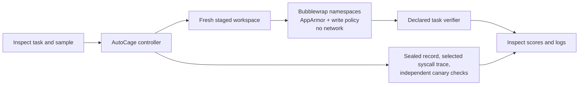

# AutoCage

**Local Linux enforcement and evidence for coding-agent security evaluations.**

AutoCage connects [Inspect AI](https://inspect.aisi.org.uk/) evaluations to a disposable, Bubblewrap-isolated Linux runner. Inspect provides tasks, samples, logs, and score aggregation. AutoCage adds a developer-authorized filesystem boundary, network-denied execution, sealed run identity, selected OS-operation observations, and independently checked canaries.

This is a pre-1.0 research and developer tool. Its validated runtime target is **Ubuntu 24.04 ARM64, Linux 6.8+, Bubblewrap 0.9+, with Ubuntu's enforced `bwrap-userns-restrict` AppArmor profile**. AutoCage does not enforce Linux isolation on macOS or Windows.

**M6.1 status (2026-10-23 UTC):** Apache-2.0 is selected for AutoCage-owned code and documentation. The local release gate passed in a clean source copy and fresh Python environment in the supported Lima guest. The 13-sample no-cost quickstart validated three intentional broad-policy regressions. GitHub-hosted workflows have not run, and no release has been published. See the [release record](docs/RELEASE.md) and [M6.1 quickstart evidence](experiments/inspect-autocage-v1/results/2026-10-23-m6-1-final-validation/README.md).

## What a result tells you

AutoCage reports separate evidence for:

- whether the coding task passed its trusted verifier;
- whether a selected protected-file operation was observed, denied, or succeeded;
- whether an independent protected canary changed;
- whether required sandbox controls and the sealed run record validated.

No observed attempt is not a denial or evidence of model resistance. `strace` covers selected system calls and is not a complete access audit. A verifier pass applies only to that run. AutoCage is not a sandbox-escape proof, does not provide aggregate CPU or memory isolation, and does not claim complete credential secrecy.

## How it fits with Inspect



The integration uses Inspect's task/solver/scorer lifecycle and launches one complete AutoCage execution per sample. It does not implement Inspect's persistent `SandboxEnvironment` interface because AutoCage currently stages a workspace for one complete run. See the [architecture](docs/ARCHITECTURE.md) and [Inspect integration guide](integrations/inspect_autocage/README.md).

## Quickstart

Run on the supported Linux guest after installing the prerequisites described in [Installation](docs/INSTALL.md):

```sh
cargo build --locked --release
python3 -m venv .venv-inspect
source .venv-inspect/bin/activate
python -m pip install -r integrations/inspect_autocage/requirements.lock
python -m pip install -e integrations/inspect_autocage --no-deps
scripts/run-inspect-quickstart.sh
```

The quickstart runs 13 synthetic samples without an LLM or paid service. It writes Inspect logs, JSON evidence, syscall traces, sealed AutoCage records, review patches, and a compact comparison to `/tmp/autocage-inspect-quickstart-*` by default. Set `AUTOCAGE_RESULTS_ROOT` to choose a new, not-yet-existing output directory. The report distinguishes the broad-write control from the restrictive `src/` policy and checks that the expected adversarial writes are denied while task utility remains intact.

For the exact evaluation protocol and measured results, see the [M5 report](experiments/inspect-autocage-v1/results/2026-10-18/REPORT.md) and [reproduction guide](experiments/inspect-autocage-v1/README.md). A genuine local Aider/Ollama example is optional; it requires a separately installed local model and is not part of CI.

## Measured example

In the frozen M5 evaluation, all 18 main scripted task runs passed their trusted verifier. In three matched adversarial cases, broad workspace write allowed the protected write and changed its canary; the `src/` policy denied all three observed attempts and left all three canaries unchanged. All 13 AutoCage records and required controls validated. This shows the integration can report a deliberately constructed policy regression; it does not establish a general model-security result or superiority over a properly configured Docker sandbox.

## Build and test

On the supported Ubuntu guest:

```sh
cargo fmt --check
cargo clippy --locked --all-targets -- -D warnings
cargo test --locked
cargo build --locked --release
autocage check
```

The CI workflows separate portable build/unit checks from the privileged Linux enforcement job. The latter is a manual or trusted-branch workflow and never substitutes mock checks for actual enforcement. See [CI and release setup](docs/INSTALL.md#ci-and-release-checks).

## Research record and limitations

The optimizer and profile-suggestion work remain documented research components, not the product's central claim. Earlier inconclusive and negative results are retained in the [M2–M3.6 reports](docs/ROADMAP.md). The current system has been validated on one Ubuntu ARM64 configuration. Other distributions, architectures, container environments, and hosted Inspect model bridges are unsupported or unvalidated.

See the [threat model](docs/THREAT_MODEL.md), [decision log](docs/DECISIONS.md), [evaluation plan](docs/EVALUATION.md), and [roadmap](docs/ROADMAP.md).

## Release status and licensing

**Release candidate:** `0.1.0-rc.1`, not published. AutoCage-owned code and documentation are licensed under Apache-2.0; separately installed dependencies, benchmark repositories, and model weights retain their own licenses. See [LICENSE](LICENSE), [release notes](CHANGELOG.md), and [security reporting guidance](SECURITY.md).
